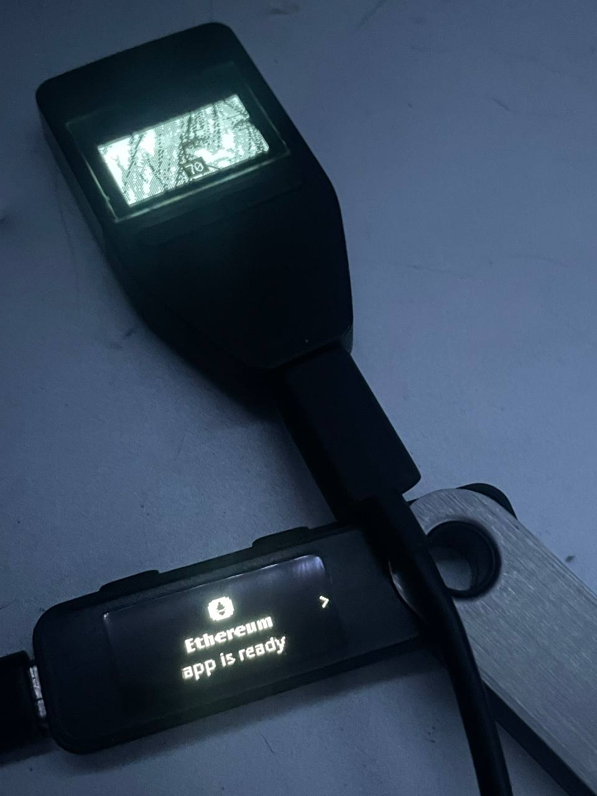

# 𝕽𝖊𝖆𝖑 𝕮𝖊𝖑𝖊𝖇𝖗𝖎𝖙𝖞
` bipolarfedd `

---

  

---

somewhere between breaking things and making them work.

 

Python · JavaScript · Go · Linux · whatever else I feel like messing with

---

### `> currently messing with`

AI / tooling / automation / web / linux

---

### `> stack`

### `> projects`

*projects, experiments, and things that started as an idea.*

---

